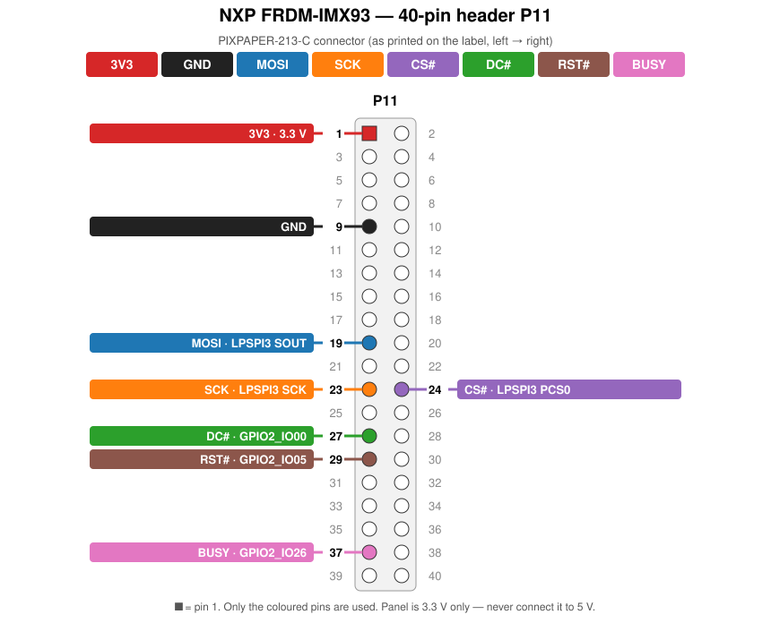

[](https://www.gnu.org/licenses/old-licenses/gpl-2.0.en.html)

# PIXPAPER-213-C on FRDM-IMX93 Cortex-M33 — FreeRTOS

The panel is driven by the **Cortex-M33** core (FreeRTOS). Linux on the Cortex-A55 only loads and starts the firmware through `remoteproc`.

| Item | Value |
|---|---|
| Board | [NXP FRDM-IMX93](https://www.nxp.com/design/design-center/development-boards-and-designs/FRDM-IMX93) |
| Tested | MCUXpresso SDK_24_12_00 |
| Source | [open-ep/freertos-frdm-imx93_m33](https://github.com/open-ep/freertos-frdm-imx93_m33) |

## Before you start

- Linux must expose the M33: `ls /sys/class/remoteproc/remoteproc0` must exist. If not, boot a device tree with M33 / rpmsg support.
- Linux must **not** use LPSPI3 or GPIO2_IO00/05/26. Do not run the [A55 Linux guide](FRDM-IMX93_PIXPAPAER-213-C.md) at the same time — it uses the same pins.

## 1. Wiring

Same pins as the A55 guide. Power the board off before wiring; the panel is **3.3 V only**.



| Panel | P11 pin | SoC signal |
|---|---|---|
| 3V3 | 1 | 3.3 V |
| GND | 9 (any GND) | GND |
| MOSI | 19 | LPSPI3 SOUT |
| SCK | 23 | LPSPI3 SCK |
| CS# | 24 | LPSPI3 PCS0 |
| DC# | 27 | GPIO2_IO00 |
| RST# | 29 | GPIO2_IO05 |
| BUSY | 37 | GPIO2_IO26 |

## 2. Build the firmware

Build on an x86-64 Ubuntu PC (20.04+) **or** directly on the board (Ubuntu 24.04 on the A55). Only the toolchain file differs:

| Build on | Toolchain file |
|---|---|
| x86-64 PC | `arm-gnu-toolchain-12.2.mpacbti-rel1-x86_64-arm-none-eabi.tar.xz` |
| the board (aarch64) | `arm-gnu-toolchain-12.2.mpacbti-rel1-aarch64-arm-none-eabi.tar.xz` |

```bash
sudo apt install -y cmake git wget xz-utils

# toolchain → /opt/m33/toolchain   (replace x86_64 with aarch64 when building on the board)
TC=arm-gnu-toolchain-12.2.mpacbti-rel1-x86_64-arm-none-eabi
wget https://developer.arm.com/-/media/Files/downloads/gnu/12.2.mpacbti-rel1/binrel/$TC.tar.xz
sudo mkdir -p /opt/m33 && sudo tar xf $TC.tar.xz -C /opt/m33 && sudo mv /opt/m33/$TC /opt/m33/toolchain
export ARMGCC_DIR=/opt/m33/toolchain

git clone https://github.com/open-ep/freertos-frdm-imx93_m33.git
cd freertos-frdm-imx93_m33/boards/mcimx93evk/driver_examples/lpspi/pixpaper-213/master/armgcc
./build_release.sh
cp release/lpspi_polling_b2b_transfer_master.elf ~/pixpaper-c-213-demo.elf
```

(The project folder is named `mcimx93evk`; the same build runs on FRDM-IMX93.)

**Check:** `ls ~/pixpaper-c-213-demo.elf` exists.

## 3. Run it on the M33

Copy `pixpaper-c-213-demo.elf` to the board (scp / USB stick), then on the board:

```bash
# Ubuntu: tell the firmware loader where the .elf is (Yocto: put the .elf in /lib/firmware and skip this line)
echo -n "$HOME/" | sudo tee /sys/module/firmware_class/parameters/path

echo -n pixpaper-c-213-demo.elf | sudo tee /sys/class/remoteproc/remoteproc0/firmware
echo -n start | sudo tee /sys/class/remoteproc/remoteproc0/state
cat /sys/class/remoteproc/remoteproc0/state        # → running
```

Stop it with `echo -n stop | sudo tee /sys/class/remoteproc/remoteproc0/state`.

## 4. Expected result

The panel flashes for **15–25 s** (normal for a 4-colour full refresh), then shows the sample image.

https://github.com/user-attachments/assets/8735993e-a415-4dd4-976f-4e2e4e37c123

## Troubleshooting

| Symptom | Fix |
|---|---|
| `remoteproc0` does not exist | The device tree has no M33 support — boot an M33 / rpmsg device tree. |
| `start` fails: `Direct firmware load ... failed` | Wrong path. `firmware_class/parameters/path` must be the folder (with trailing `/`) that holds the `.elf`. |
| Board freezes right after `start` | Linux has gated the LPSPI3 / GPIO2 clocks that the M33 uses. Make sure Linux does not use LPSPI3/GPIO2 and does not turn their clocks off. |
| State is `running`, screen never changes | Check 3V3 / GND, then that MOSI and SCK are not swapped. |

## Contributors

Thanks goes to these wonderful people from open source community:

<!-- ALL-CONTRIBUTORS-LIST:START - Do not remove or modify this section -->
<!-- prettier-ignore-start -->
<!-- markdownlint-disable -->
<table>
  <tbody>
    <tr>
        <td align="center" valign="top" width="14.28%"><a href="https://github.com/wigcheng"><br /><sub><b>Wig Cheng</b></sub></a><br /><a href="https://github.com/wigcheng/open-epd/commits?author=wigcheng" title="Code">💻</a></td>
    </tr>
  </tbody>
</table>

<!-- markdownlint-restore -->
<!-- prettier-ignore-end -->

<!-- ALL-CONTRIBUTORS-LIST:END -->

---
