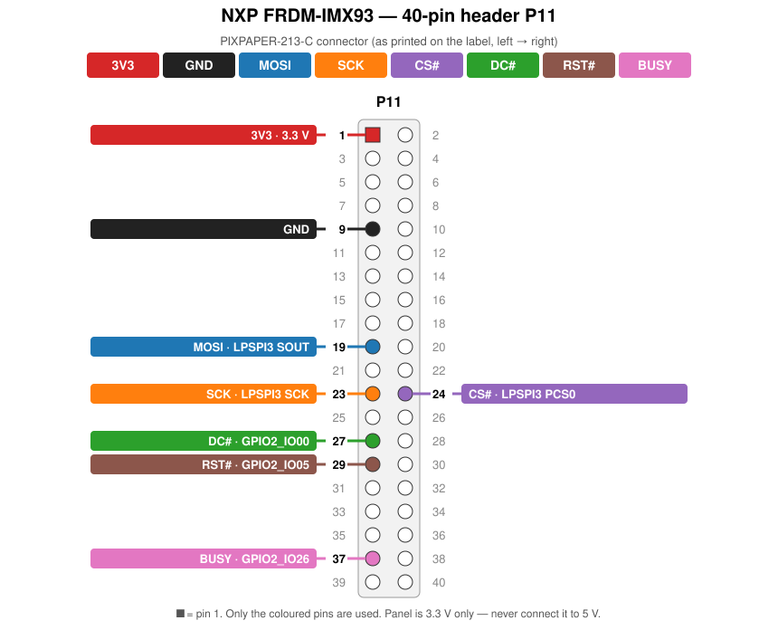

[](https://www.gnu.org/licenses/old-licenses/gpl-2.0.en.html)

# PIXPAPER-213-C on NXP FRDM-IMX93 — Linux

| Item | Value |
|---|---|
| Board | [NXP FRDM-IMX93 (Cortex-A55)](https://www.nxp.com/design/design-center/development-boards-and-designs/FRDM-IMX93) |
| Tested | kernel 6.6, 6.12 |
| Interface | `/dev/spidev0.0` + 3 GPIOs on `gpiochip0` |
| Demo source | [pixpaper-213-c-test-frdm-imx93.c](https://github.com/open-ep/linux-user-space-examples/blob/master/2.13/color/spi/pixpaper-213-c-test-frdm-imx93.c) |

> Want to drive the panel from the Cortex-M33 core instead? See the [FRDM-IMX93 M33 guide](FRDM-IMX93-M33_PIXPAPAER-213-C.md). Do not run both at the same time — they use the same pins.

## 1. Wiring

Power the board off before wiring. The panel is **3.3 V only** — never use a 5 V pin.



| Panel | P11 pin | SoC signal |
|---|---|---|
| 3V3 | 1 | 3.3 V |
| GND | 9 (any GND) | GND |
| MOSI | 19 | LPSPI3 SOUT |
| SCK | 23 | LPSPI3 SCK |
| CS# | 24 | LPSPI3 PCS0 |
| DC# | 27 | GPIO2_IO00 (gpiochip0 line 0) |
| RST# | 29 | GPIO2_IO05 (line 5) |
| BUSY | 37 | GPIO2_IO26 (line 26) |

<details><summary>Photo of a finished setup</summary>


</details>

## 2. Enable SPI

Nothing to do — the stock image already provides the SPI device.

**Check:** `ls /dev/spidev0.0` prints `/dev/spidev0.0`.

## 3. Build and run the demo

> Needs **libgpiod 1.x** — check with `gpioinfo --version` (must say `v1.x`). With libgpiod 2.x the build fails — see Troubleshooting.

> Yocto image: add `IMAGE_INSTALL:append = " libgpiod libgpiod-dev libgpiod-tools packagegroup-core-buildessential"` to `conf/local.conf`, rebuild, then run the commands below on the board (skip the `apt` line).

```bash
sudo apt install -y gcc wget gpiod libgpiod-dev
mkdir -p ~/pixpaper-213c && cd ~/pixpaper-213c
BASE=https://raw.githubusercontent.com/open-ep/linux-user-space-examples/master/2.13/color/spi
wget $BASE/pixpaper-213-c-test-frdm-imx93.c $BASE/png_HEX.h
gcc -o epd_test pixpaper-213-c-test-frdm-imx93.c -lgpiod
sudo ./epd_test
```

## 4. Expected result

The panel flashes for **15–25 s** (normal for a 4-colour full refresh), then shows the sample image. The demo redraws every 30 s until you press **Ctrl+C**.

https://github.com/user-attachments/assets/8735993e-a415-4dd4-976f-4e2e4e37c123

## 5. Show your own picture

```bash
sudo apt install -y python3-opencv
wget $BASE/png2epd.py
# save your picture as test.png: exactly 250 × 122 px (landscape)
python3 png2epd.py                    # test.png → png_HEX.h
gcc -o epd_test pixpaper-213-c-test-frdm-imx93.c -lgpiod && sudo ./epd_test
```

`png2epd.py` does **not** resize or dither. It keeps only 3 exact colours — black `#000000`, red `#FF0000`, yellow `#FFFF00`; every other colour becomes white. It can also run on your PC; just copy `png_HEX.h` to the board.

## Troubleshooting

| Symptom | Fix |
|---|---|
| `/dev/spidev0.0` missing | SPI is not enabled → redo step 2 and reboot. |
| `/dev/spidev0.0` missing | Your device tree does not put a spidev on LPSPI3. Use the stock NXP image, or add a `spidev` child node to `&lpspi3`. |
| Compile error `implicit declaration of function 'gpiod_chip_open_by_name'` | Your OS has libgpiod 2.x. Use an image with libgpiod 1.x. |
| `Failed to request GPIO` / line busy | Another driver owns GPIO2_IO00/05/26. `gpioinfo gpiochip0` shows the user. If you rewire, edit `EPD_DC_PIN` / `EPD_RST_PIN` / `EPD_BUSY_PIN` in the `.c`. |
| Runs, but the screen never changes | Check 3V3 and GND first, then that MOSI and SCK are not swapped. |
| Hangs at 100 % CPU, no flashing | BUSY or RST# wire is loose (BUSY idles high, low = busy). |

## Contributors

Thanks goes to these wonderful people from open source community:

<!-- ALL-CONTRIBUTORS-LIST:START - Do not remove or modify this section -->
<!-- prettier-ignore-start -->
<!-- markdownlint-disable -->
<table>
  <tbody>
    <tr>
        <td align="center" valign="top" width="14.28%"><a href="https://github.com/wigcheng"><br /><sub><b>Wig Cheng</b></sub></a><br /><a href="https://github.com/wigcheng/open-epd/commits?author=wigcheng" title="Code">💻</a></td>
    </tr>
  </tbody>
</table>

<!-- markdownlint-restore -->
<!-- prettier-ignore-end -->

<!-- ALL-CONTRIBUTORS-LIST:END -->

---
