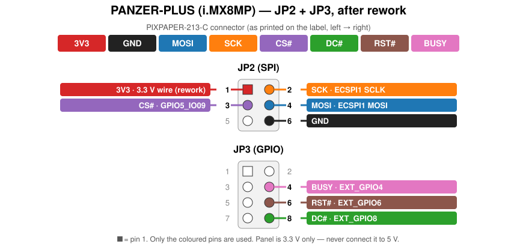

[](https://www.gnu.org/licenses/old-licenses/gpl-2.0.en.html)

# PIXPAPER-213-C on PANZER-PLUS (i.MX8MP) — Linux

| Item | Value |
|---|---|
| Board | PANZER-PLUS (NXP i.MX8MP, device tree `imx8mp-b643-ppc.dts`) |
| Tested | kernel 5.15, 6.6 |
| Interface | `/dev/spidev1.0` + 3 GPIOs on `gpiochip5` |
| Demo source | [pixpaper-213-c-test-imx8mp.c](https://github.com/open-ep/linux-user-space-examples/blob/master/2.13/color/spi/pixpaper-213-c-test-imx8mp.c) |

## 0. Hardware rework (one-time)

The stock PANZER-PLUS routes these pins to a UART, not SPI. Pick one:

- **Rework the board yourself:**
  1. Remove **U131**.
  2. On the empty U131 footprint, solder a wire across each pair: pad 26 ↔ pad 40, pad 34 ↔ pad 20, pad 33 ↔ pad 21, pad 25 ↔ pad 5.
  3. Solder a 3.3 V wire to **JP2 pin 1** (it is not connected from the factory).
- Ask Open-EP for a reworked board.
- Or use a USB-to-SPI dongle instead (not covered here).

## 1. Wiring

Power the board off before wiring. The panel is **3.3 V only** — never use a 5 V pin.



| Panel | Header pin | Signal |
|---|---|---|
| 3V3 | JP2-1 (rework wire) | 3.3 V |
| GND | JP2-6 | GND |
| MOSI | JP2-4 | ECSPI1 MOSI |
| SCK | JP2-2 | ECSPI1 SCLK |
| CS# | JP2-3 | GPIO5_IO09 |
| DC# | JP3-8 | EXT_GPIO8 = PCA9555 line 15 |
| RST# | JP3-6 | EXT_GPIO6 = PCA9555 line 13 |
| BUSY | JP3-4 | EXT_GPIO4 = PCA9555 line 11 |

## 2. Enable SPI

Switch ECSPI1's pins from UART3 to SPI in `arch/arm64/boot/dts/freescale/imx8mp-b643-ppc.dts`:

1. Rename the existing `&ecspi2` node to `&ecspi1` and change its pins / chip-select:

```diff
-&ecspi2 {
+&ecspi1 {
 	#address-cells = <1>;
 	#size-cells = <0>;
-	fsl,spi-num-chipselects = <1>;
+	num-cs = <1>;
 	pinctrl-names = "default";
-	pinctrl-0 = <&pinctrl_ecspi2 &pinctrl_ecspi2_cs>;
-	cs-gpios = <&gpio5 13 GPIO_ACTIVE_LOW>;
+	pinctrl-0 = <&pinctrl_ecspi1 &pinctrl_ecspi1_cs>;
+	cs-gpios = <&gpio5 9 GPIO_ACTIVE_LOW>;
 	status = "okay";
```

2. Delete the whole `&uart3 { ... };` node.

3. In `&iomuxc`, replace the `pinctrl_uart3: uart3grp { ... };` group with:

```dts
	pinctrl_ecspi1: ecspi1grp {
		fsl,pins = <
			MX8MP_IOMUXC_ECSPI1_SCLK__ECSPI1_SCLK		0x140
			MX8MP_IOMUXC_ECSPI1_MOSI__ECSPI1_MOSI		0x140
			MX8MP_IOMUXC_ECSPI1_MISO__ECSPI1_MISO		0x140
		>;
	};

	pinctrl_ecspi1_cs: ecspi1cs {
		fsl,pins = <
			MX8MP_IOMUXC_ECSPI1_SS0__GPIO5_IO09		0x140
		>;
	};
```

4. Rebuild the dtb, copy it over the old one in the boot partition, reboot.

**Check:** `ls /dev/spidev1.0` prints `/dev/spidev1.0`.

## 3. Build and run the demo

> Needs **libgpiod 1.x** — check with `gpioinfo --version` (must say `v1.x`). With libgpiod 2.x the build fails — see Troubleshooting.

> Yocto image: add `IMAGE_INSTALL:append = " libgpiod libgpiod-dev libgpiod-tools packagegroup-core-buildessential"` to `conf/local.conf`, rebuild, then run the commands below on the board (skip the `apt` line).

```bash
sudo apt install -y gcc wget gpiod libgpiod-dev
mkdir -p ~/pixpaper-213c && cd ~/pixpaper-213c
BASE=https://raw.githubusercontent.com/open-ep/linux-user-space-examples/master/2.13/color/spi
wget $BASE/pixpaper-213-c-test-imx8mp.c $BASE/png_HEX.h
gcc -o epd_test pixpaper-213-c-test-imx8mp.c -lgpiod
sudo ./epd_test
```

## 4. Expected result

The panel flashes for **15–25 s** (normal for a 4-colour full refresh), then shows the sample image (progress bars on a black background). The demo redraws every 30 s until you press **Ctrl+C**.


## 5. Show your own picture

```bash
sudo apt install -y python3-opencv
wget $BASE/png2epd.py
# save your picture as test.png: exactly 250 × 122 px (landscape)
python3 png2epd.py                    # test.png → png_HEX.h
gcc -o epd_test pixpaper-213-c-test-imx8mp.c -lgpiod && sudo ./epd_test
```

`png2epd.py` does **not** resize or dither. It keeps only 3 exact colours — black `#000000`, red `#FF0000`, yellow `#FFFF00`; every other colour becomes white. It can also run on your PC; just copy `png_HEX.h` to the board.

## Troubleshooting

| Symptom | Fix |
|---|---|
| `/dev/spidev1.0` missing | SPI is not enabled → redo step 2 and reboot. |
| `gpiochip5` not found / wrong lines | DC/RST/BUSY are on the PCA9555 expander; its gpiochip number depends on probe order. Run `gpiofind EXT_GPIO8` — it prints e.g. `gpiochip5 15`. Put that chip name in `EPD_GPIO_CHIP`. |
| `/dev/spidev1.0` missing but another `spidevN.0` exists | Bus numbering differs on your kernel. Put the name you see in `EPD_SPI_DEVICE` in the `.c`. |
| Compile error `implicit declaration of function 'gpiod_chip_open_by_name'` | Your OS has libgpiod 2.x. Use an image with libgpiod 1.x. |
| `Failed to request GPIO` / line busy | Another driver owns PCA9555 lines 11/13/15. `gpioinfo gpiochip5` shows the user. If you rewire, edit `EPD_DC_PIN` / `EPD_RST_PIN` / `EPD_BUSY_PIN` in the `.c`. |
| Runs, but the screen never changes | Check 3V3 and GND first, then that MOSI and SCK are not swapped. |
| Hangs at 100 % CPU, no flashing | BUSY or RST# wire is loose (BUSY idles high, low = busy). |

## Contributors

Thanks goes to these wonderful people from open source community:

<!-- ALL-CONTRIBUTORS-LIST:START - Do not remove or modify this section -->
<!-- prettier-ignore-start -->
<!-- markdownlint-disable -->
<table>
  <tbody>
    <tr>
      <td align="center" valign="top" width="14.28%"><a href="https://github.com/wigcheng"><br /><sub><b>Wig Cheng</b></sub></a><br /><a href="https://github.com/wigcheng/open-epd/commits?author=wigcheng" title="Code">💻</a></td>
<td align="center" valign="top" width="14.28%"><a href="https://github.com/meteorTriangle"><br /><sub><b>Triangle Alien</b></sub></a><br />💻</td>
    </tr>
  </tbody>
</table>

<!-- markdownlint-restore -->
<!-- prettier-ignore-end -->

<!-- ALL-CONTRIBUTORS-LIST:END -->

---
