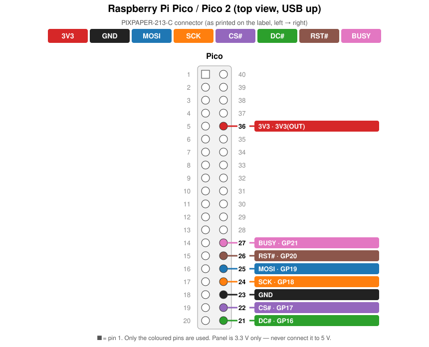

[](https://www.gnu.org/licenses/old-licenses/gpl-2.0.en.html)

# PIXPAPER-213-C on Raspberry Pi Pico / Pico 2 — Pico SDK

| Item | Value |
|---|---|
| Board | [Raspberry Pi Pico 2](https://www.raspberrypi.com/products/raspberry-pi-pico-2/) ✔, Raspberry Pi Pico ✔ |
| Toolchain | VS Code + official *Raspberry Pi Pico* extension (Windows / Linux / macOS) |
| Source | [meteorTriangle/EPDA0213E5_4C](https://github.com/meteorTriangle/EPDA0213E5_4C) |

> Using Zephyr instead? See the [W6300-EVB-Pico2 / Pico 2 Zephyr guide](ZEPHYR-W6300-EVB-PICO2_PIXPAPAER-213-C.md) — it uses **different pins** (GP2–GP7).

## 1. Wiring

Unplug USB before wiring. The panel is **3.3 V only** — use `3V3(OUT)`, never `VBUS` / `VSYS`.



| Panel | Pico pin | GPIO |
|---|---|---|
| 3V3 | 36 | 3V3(OUT) |
| GND | 23 (any GND) | GND |
| MOSI | 25 | GP19 (SPI0 TX) |
| SCK | 24 | GP18 (SPI0 SCK) |
| CS# | 22 | GP17 |
| DC# | 21 | GP16 |
| RST# | 26 | GP20 |
| BUSY | 27 | GP21 |

<details><summary>Original wiring picture</summary>


</details>

## 2. Build and flash

1. Install [VS Code](https://code.visualstudio.com/) and the **Raspberry Pi Pico** extension.
2. Get the code:
   ```bash
   git clone https://github.com/meteorTriangle/EPDA0213E5_4C
   ```
3. In VS Code: Pico extension → **Import Project** → select the `EPDA0213E5_4C` folder.
   The project targets **Pico 2**. For the original Pico, change `set(PICO_BOARD pico2 ...)` to `pico` in `CMakeLists.txt` first.
4. Hold **BOOTSEL**, plug in USB, release. Click **Run** (compile + flash) in the status bar.

## 3. Expected result

The panel flashes for **15–25 s** (normal for a 4-colour full refresh), then shows the image.

https://github.com/user-attachments/assets/ced76960-1656-456d-a9b5-52f5efae2fb5

## Troubleshooting

| Symptom | Fix |
|---|---|
| Screen never changes | Check 3V3 (pin 36) and GND, then that MOSI (GP19) and SCK (GP18) are not swapped. |
| Different wiring | Edit the pin numbers in `extern/EPDA0213E5_4C_RPIMCU_driver/epd_lib.h` (`EPD_SPI_TX`, `EPD_SPI_SCK`, `EPD_SPI_CS`, `EPD_DC`, `EPD_RST`, `EPD_BUSY`), rebuild. MOSI/SCK must stay on SPI0-capable pins. |
| Own picture | Use the converter in the repo's `png2bitmap/` folder (see its README). |

## Contributors

Thanks goes to these wonderful people from open source community:

<!-- ALL-CONTRIBUTORS-LIST:START - Do not remove or modify this section -->
<!-- prettier-ignore-start -->
<!-- markdownlint-disable -->
<table>
  <tbody>
    <tr>
<td align="center" valign="top" width="14.28%"><a href="https://github.com/meteorTriangle"><br /><sub><b>Triangle Alien</b></sub></a><br />💻</td>
    </tr>
  </tbody>
</table>

<!-- markdownlint-restore -->
<!-- prettier-ignore-end -->

<!-- ALL-CONTRIBUTORS-LIST:END -->

---
