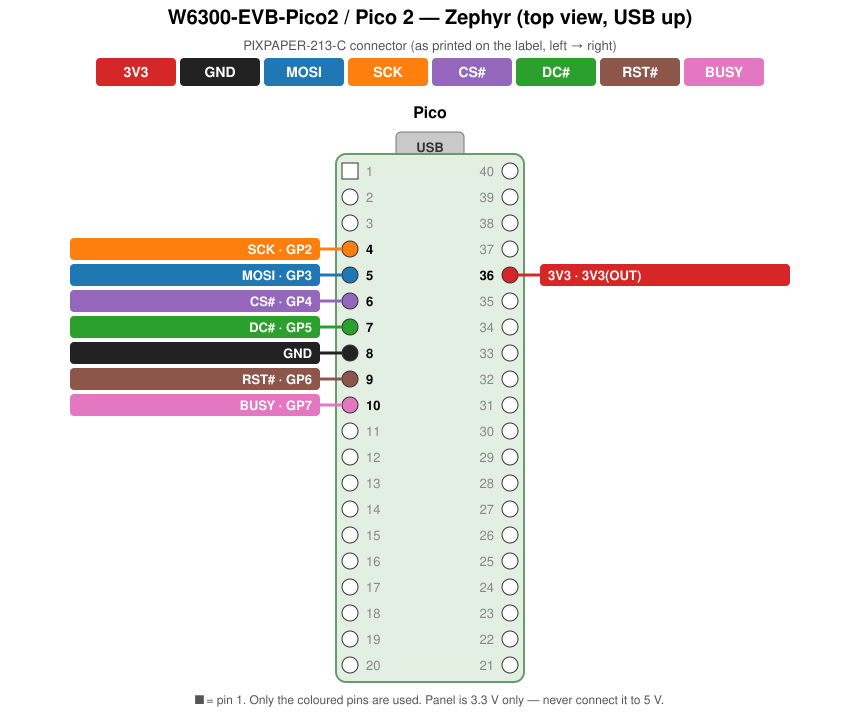

[](https://www.gnu.org/licenses/old-licenses/gpl-2.0.en.html)

# PIXPAPER-213-C on W6300-EVB-Pico2 / Raspberry Pi Pico 2 — Zephyr

| Item | Value |
|---|---|
| Board | [WIZnet W6300-EVB-Pico2](https://docs.wiznet.io/Product/Chip/Ethernet/W6300/w6300-evb-pico2) (`w6300_evb_pico2/rp2350a/m33`) or Raspberry Pi Pico 2 (`rpi_pico2/rp2350a/m33`) |
| Host | Ubuntu (x86-64) |
| Zephyr | upstream board support, Zephyr SDK ≥ 1.0 |
| Source | [zephyr-user-space-examples → w6300_evb_pico2/samples/pixpaper_213c](https://github.com/open-ep/zephyr-user-space-examples/tree/main/boards/w6300_evb_pico2/samples/pixpaper_213c) |

The sample only uses GP2–GP7 and never touches the W6300 chip, so a bare Pico 2 works the same.
It alternates a bundled picture and a 4-colour bar pattern every 30 s. The image is 7750 B (0.4 % of the 2 MB flash).

> Using the Pico SDK instead? See the [Pico guide](RPI-PICO_PIXPAPAER-213-C.md) — it uses **different pins** (GP16–GP21).

## 1. Wiring

Unplug USB before wiring. The panel is **3.3 V only** — use `3V3(OUT)`, never `VBUS` / `VSYS`.



| Panel | Header pin | GPIO |
|---|---|---|
| 3V3 | 36 | 3V3(OUT) |
| GND | 8 | GND |
| MOSI | 5 | GP3 |
| SCK | 4 | GP2 |
| CS# | 6 | GP4 |
| DC# | 7 | GP5 |
| RST# | 9 | GP6 |
| BUSY | 10 | GP7 |

All signals sit on header pins 4–10 on one edge, away from the W6300 (GP15–GP22) and the console UART (GP0/GP1). SPI is bit-banged on these GPIOs.

Optional console: UART0 TX = GP0, RX = GP1, 115200 8N1, through a 3.3 V USB-UART dongle.

## 2. Install the toolchain (once per PC)

```bash
sudo apt install -y cmake ninja-build device-tree-compiler python3-venv wget git
cd ~
wget https://github.com/zephyrproject-rtos/sdk-ng/releases/download/v1.0.1/zephyr-sdk-1.0.1_linux-x86_64_minimal.tar.xz
tar xf zephyr-sdk-1.0.1_linux-x86_64_minimal.tar.xz
cd zephyr-sdk-1.0.1
./setup.sh -t arm-zephyr-eabi -c   # -c registers it so west finds it
```

## 3. Create the Zephyr workspace (once)

```bash
mkdir ~/zephyrproject && cd ~/zephyrproject
python3 -m venv .venv
.venv/bin/pip install west
.venv/bin/west init .
.venv/bin/west update hal_rpi_pico cmsis_6      # only the modules this board needs
.venv/bin/pip install -r zephyr/scripts/requirements-base.txt
```

## 4. Build

```bash
git clone https://github.com/open-ep/zephyr-user-space-examples.git ~/zephyr-user-space-examples
cd ~/zephyrproject
.venv/bin/west build -p always -b w6300_evb_pico2/rp2350a/m33 \
    ~/zephyr-user-space-examples/boards/w6300_evb_pico2/samples/pixpaper_213c/apps/quick-update
```

For a plain Pico 2, use `-b rpi_pico2/rp2350a/m33`.

**Check:** `ls build/zephyr/zephyr.uf2` exists (note the extra `/zephyr/`).

## 5. Flash

1. Unplug USB, hold **BOOTSEL**, plug USB back in, release → a USB drive named `RP2350` appears.
2. Copy `build/zephyr/zephyr.uf2` onto it.
3. The board reboots into the new firmware by itself.

After that the board no longer shows up on USB (the sample has no USB function) — that is expected, not a failed flash. The BOOTSEL bootloader is in ROM, so you can always re-flash.

## 6. Expected result

About 1 s after power-up the panel starts a full refresh: it flashes for **15–25 s** (normal for this panel), then shows the picture. 30 s later it switches to the colour bars, and keeps alternating.

## Troubleshooting

| Symptom | Fix |
|---|---|
| No `RP2350` drive | Hold BOOTSEL **before** plugging USB in; try another cable (some are charge-only). |
| Screen never changes | Check 3V3 (pin 36) and GND, then that MOSI (GP3) and SCK (GP2) are not swapped. |
| Console prints `warn: BUSY timeout` (or the screen stays blank) | BUSY or RST# wire is loose (BUSY idles high, low = busy). The console prints `refreshing (15-25 s)...` / `done` on a good refresh. |
| `west build` cannot find a toolchain | Re-run `./setup.sh -t arm-zephyr-eabi -c` in `~/zephyr-sdk-1.0.1`. |

The mono panel uses the same board and pins: see the [pixpaper_213m sample](https://github.com/open-ep/zephyr-user-space-examples/tree/main/boards/w6300_evb_pico2/samples/pixpaper_213m).
